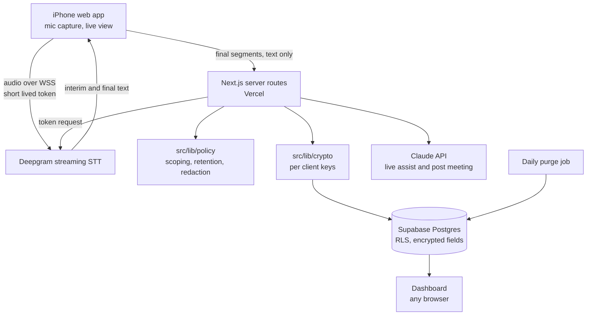

# Build Plan

Companion to SPEC.md. Revised 2026-10-30.

## 1. Architecture

One TypeScript codebase: a Next.js app that serves both the iPhone capture screen and the dashboard. Audio goes straight from the phone to the transcription vendor. Only text reaches the Listener server.



| Component | Choice | Why |
| --- | --- | --- |
| Language | TypeScript everywhere | One language for phone UI, server, and tests |
| App | Next.js (App Router), installable as a web app | No App Store, no Mac, no install on managed computers |
| Native fallback | Capacitor wrapping the same app | Only if Phase 1 shows the web app cannot hold the mic (section 4) |
| Transcription | Deepgram Nova-3 streaming, diarization on, `mip_opt_out=true` | Low latency, browser WebSocket, temporary tokens |
| Live assistant | Claude, fast model (config `models.live`) | Speed matters more than depth during a call |
| Post meeting | Claude, stronger model (config `models.post`) | Quality of summary, action items, feedback |
| Database | Supabase Postgres with row level security | Auth, Postgres, and scheduled jobs in one place |
| Auth | Supabase Auth with passkeys, sign up disabled | Face ID login, single owner |
| Encryption | Node `crypto`, AES-256-GCM, envelope keys | No extra vendor; per client keys allow crypto shredding |
| Scheduled jobs | Vercel Cron calling a protected route | Daily purge |
| Hosting | Vercel (app), Supabase (database) | Managed, low maintenance |
| Tests | Vitest (unit), Playwright (browser flows) | Policy functions get unit tests (CLAUDE.md rule 4) |

### Recall without a vector database

The first version does not use embeddings. One owner's data for a single client is small enough to fit in the model's context: the project brief, open action items, recent summaries, and key quotes. With prompt caching, this is fast and cheap. It also avoids storing embeddings, which are not encrypted and can leak the text they came from. Embeddings are reconsidered only when a client's data exceeds the `recall.max_context_tokens` budget in config.

## 2. Repository Layout

```
src/
  app/                 Next.js routes (capture screen, dashboard, API routes)
  lib/
    policy/            Pure functions: scoping, retention, redaction. Unit tested.
    crypto/            Envelope encryption, per client data keys. Unit tested.
    db/                Data access layer. Every function takes client_id.
    stt/               Deepgram token issue (server), stream client (browser)
    assist/            Prompts and calls for live assist, recall, post meeting
    config.ts          Loads and validates config.yaml (zod)
supabase/
  migrations/          SQL schema and RLS policies
tests/
  unit/                Vitest
  e2e/                 Playwright
config.yaml            All parameters (CLAUDE.md rule 6)
```

## 3. Data Model

Encrypted columns end in `_enc` and hold `nonce || ciphertext || tag`, base64.

| Table | Key columns | Retention |
| --- | --- | --- |
| clients | id, name_enc, wrapped_dek, created_at | Until deleted |
| projects | id, client_id, name_enc, brief_enc, status | Until deleted |
| meetings | id, client_id, project_id, template, started_at, ended_at, speaker_map_enc | Until deleted |
| transcript_segments | id, client_id, meeting_id, seq, speaker, start_ms, end_ms, text_enc, expires_at | 30 days (config) |
| suggestion_cards | id, client_id, meeting_id, kind, body_enc, pinned, expires_at | With transcript unless pinned |
| summaries | id, client_id, meeting_id, version, summary_enc, decisions_enc, quotes_enc, feedback_enc, tags, created_at | Until deleted |
| action_items | id, client_id, project_id, meeting_id, title_enc, owner_enc, due_date, status, source_quote_enc, source_ms, created_at, closed_at | Until deleted |
| audit_log | id, at, event, client_id, object_id, count | 365 days (config) |

Indexes on `(client_id, ...)` for every table and on `transcript_segments.expires_at`.

Wrapped data keys are stored in `clients.wrapped_dek`. The master key that unwraps them is the `LISTENER_MASTER_KEY` environment variable on Vercel and never in the database, so a database dump alone is unreadable.

## 4. Known Risk: iOS Microphone in a Web App

WebKit bug reports show that microphone capture in iOS web apps can stop when the app is backgrounded, when Control Center opens, after a phone call interrupts audio, or in some versions only when launched from the Home Screen rather than from Safari. Because the phone is docked and the app stays in the foreground with the screen awake, most of these are avoidable, but this must be proven before anything else is built.

Phase 1 tests both launch modes (Safari tab and Home Screen). If neither holds a 60 minute call, the app is wrapped with Capacitor and a native audio plugin before Phase 2. That is a decision gate, not a silent switch: stop and report.

## 5. Phases

Each phase ends with its Done criteria met, a summary, and a stop (CLAUDE.md rule 10).

### Phase 1: Capture spike

Goal: prove the phone can hold a live transcription stream for a full call.

- Next.js and TypeScript scaffold, Vitest, Playwright, config loader with schema validation.
- Server route that issues a Deepgram temporary token. The phone never sees the API key.
- Interim access gate: one long passphrase (`LISTENER_ACCESS_CODE`) unlocks a signed, expiring cookie, so nobody else can spend Deepgram credit through the token route. Replaced by passkeys in Phase 2.
- Capture screen: start and stop, mic stream to Deepgram, live transcript with speaker labels, wake lock, recording indicator, elapsed time.
- Reconnect on socket drop with a new token. Silence and stall detection with an on screen alert.
- Nothing is stored. Transcript lives in page memory only.
- Diagnostics panel showing latency, reconnect count, and audio level (no content logged).

Done when:

- Unit tests pass for the config loader and the token route (key never in the response).
- A 60 minute docked call in Safari tab mode holds without manual intervention, or recovers within `capture.stall_alert_seconds`.
- The same test is run in Home Screen mode and the result recorded in `docs/phase1-results.md`.
- Measured speech to final text latency is under `capture.target_latency_ms` on Wi-Fi.

### Phase 2: Secure data foundation

- Supabase project, migrations, RLS policies.
- Passkey sign in, sign up disabled, idle session timeout.
- `src/lib/crypto`: data key generation, wrap and unwrap, field encrypt and decrypt. Tests include tamper detection and wrong key rejection.
- `src/lib/policy`: `assertClientScope`, `computeExpiresAt`, `redact`, `isPurgeable`. Tests for each.
- Clients and projects CRUD.
- Start meeting with client and project selection. Final segments saved encrypted with `expires_at`.
- Daily purge job and its audit count.
- Logger that runs `redact` on everything.

Done when: every policy and crypto function has tests, a test proves a query without `client_id` fails, a test proves expired segments are purged, and a grep based test proves no logger call receives raw transcript fields.

### Phase 3: Post meeting outputs and dashboard

- End meeting pipeline: summary, decisions, action items, key quotes, feedback, tags, using structured output validated with zod.
- Review and edit screen. Edits create a new summary version.
- Speaker mapping, with "Me" used for talk time ratio.
- Dashboard: client and project views, meeting detail with transcript expiry label, consolidated open items.

Done when: outputs are ready within `assist.post_meeting_timeout_seconds` on a 60 minute transcript, action item schema validation has tests, and a test proves the open items view never calls the model.

### Phase 4: Live assistant and recall

- Project brief editor and templates (from `config.yaml`).
- Live loop on `assist.live_interval_seconds` plus triggers (question to owner, commitment or date mentioned, brief open question mentioned).
- Suggestion cards with dismiss and pin.
- Recall box: answers from the current client's data only, with citations, and "not found" when absent.
- Prompt caching for the client context block.

Done when: a test proves a recall prompt for client A contains no data from client B, trigger detection has unit tests, and live suggestions appear within `assist.live_max_latency_ms` of a trigger in a manual test.

### Phase 5: Reminders and workflows

Not started until SPEC section 8 is expanded into a full section.

## 6. Hosting Notes

- Vercel project with environment variables: `DEEPGRAM_API_KEY`, `ANTHROPIC_API_KEY`, `SUPABASE_URL`, `SUPABASE_ANON_KEY`, `SUPABASE_SERVICE_ROLE_KEY` (purge job only), `LISTENER_MASTER_KEY`, `CRON_SECRET`.
- Supabase backups: record the plan's backup retention here once the project is created. Effective transcript life is the transcript retention plus this period. Client deletion destroys the wrapped data key, so backups of that client become unreadable.
- Confirm before production: Deepgram retention terms with `mip_opt_out=true` (opting out removes Deepgram's model improvement discount), Anthropic API data retention terms, and Supabase and Vercel data processing terms.

## 7. Cost Notes

Rough drivers, to be measured in Phase 1 and 3 rather than assumed: Deepgram streaming minutes, Claude tokens for live assist (the largest variable, controlled by `assist.live_interval_seconds`), Claude tokens for post meeting, and Supabase and Vercel plans.
